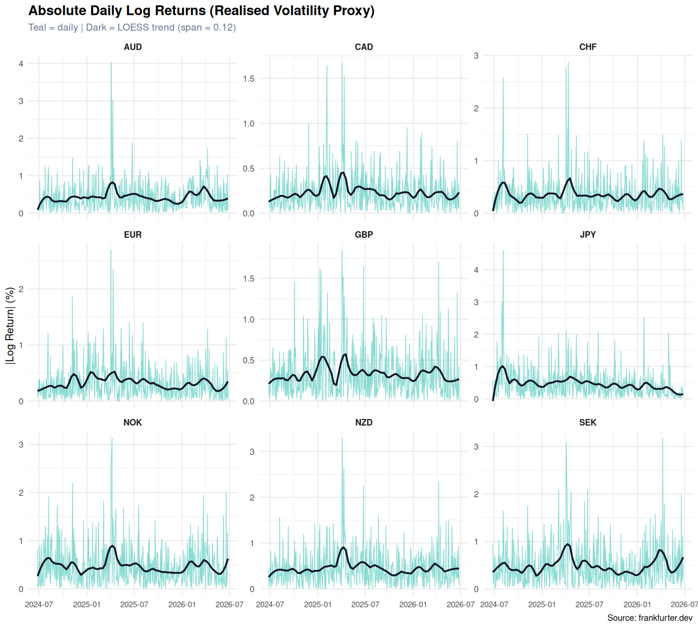

::: {.status}
The code is on [GitHub](https://github.com/NavyBlueCheese/g10-fx-analysis).
:::

A statistical look at two years of daily G10 exchange rates against the
dollar, pulled live from the [Frankfurter API](https://frankfurter.dev)
and analysed in R. The notebook asks four questions:

- Which currencies move together, and how strongly?
- How fat are the return tails compared with a normal distribution?
- How stable are risk-adjusted returns over rolling 30-day windows?
- Is there volatility clustering, the precondition for GARCH-type models?

{fig-alt="Correlation heatmap of nine G10 currencies against USD. AUD and NZD correlate at 0.89; JPY has the weakest correlations with the commodity currencies."}

The clustering pulls out the groups you'd expect. AUD and NZD move
almost together (0.89), the European currencies form a block, and JPY is
the odd one out, tied mainly to CHF and much more loosely to the
commodity currencies.

{fig-alt="Absolute daily returns for each currency over two years, showing calm and turbulent stretches grouped together."}

A GitHub Action re-renders the notebook on every push, so the figures
in the repository stay current.
